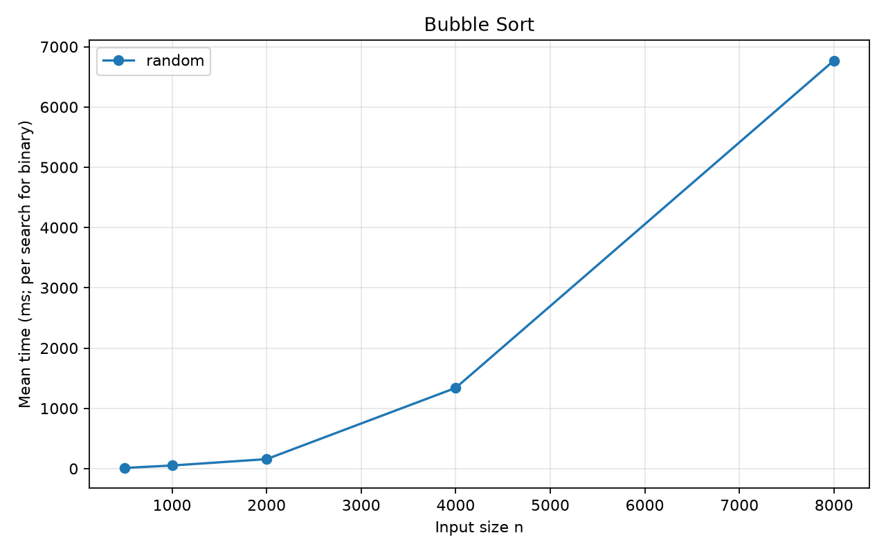
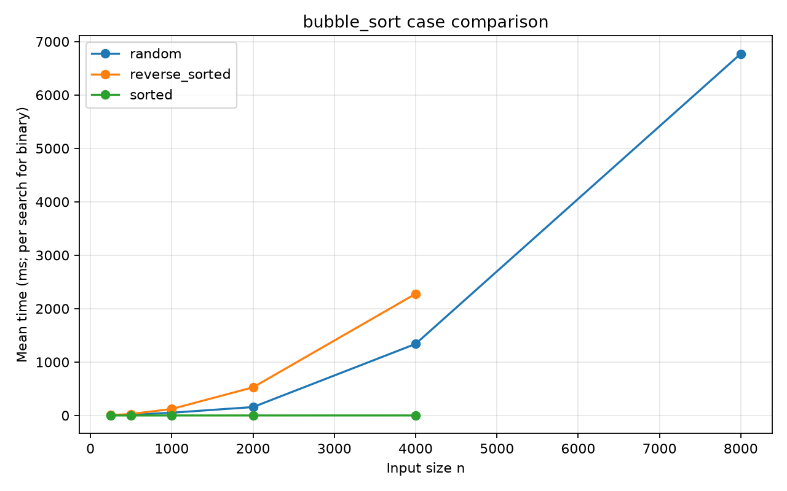
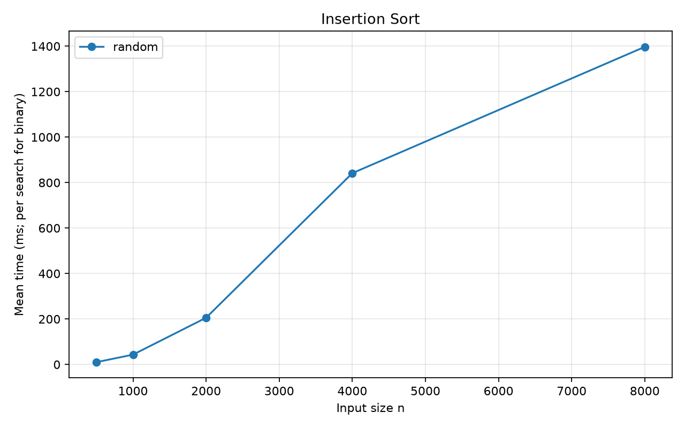
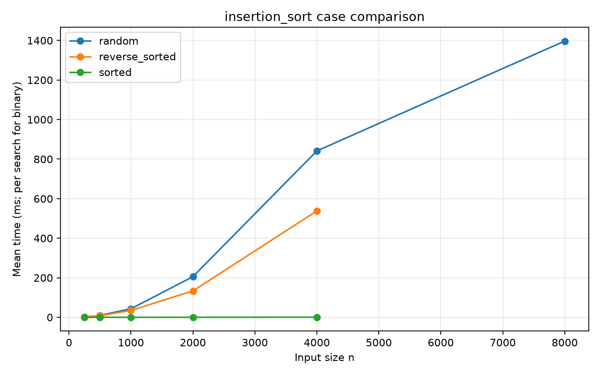
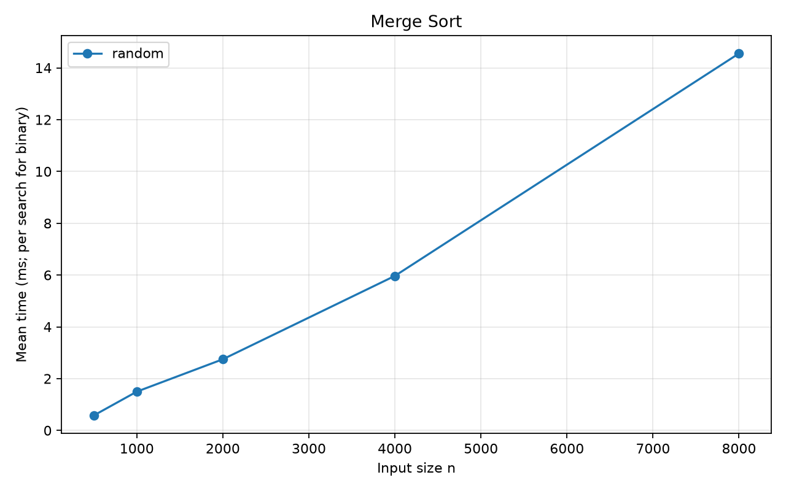
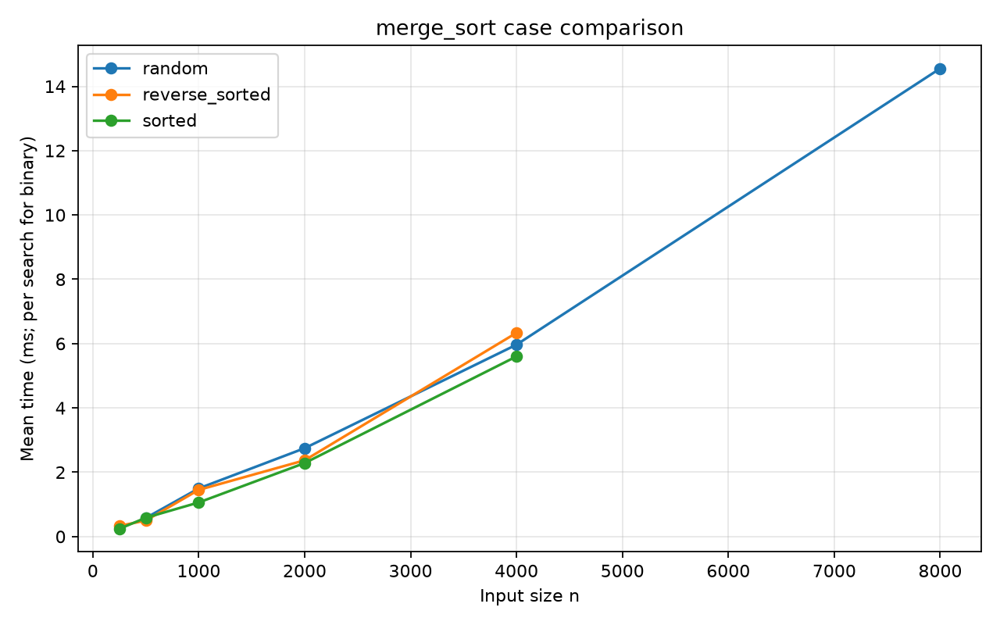
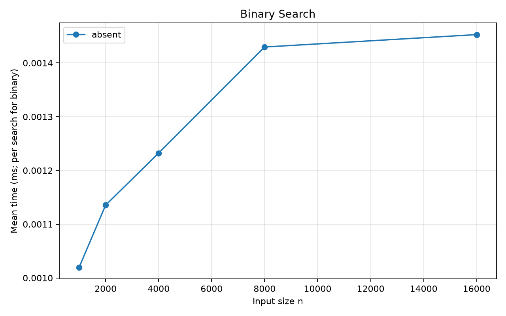
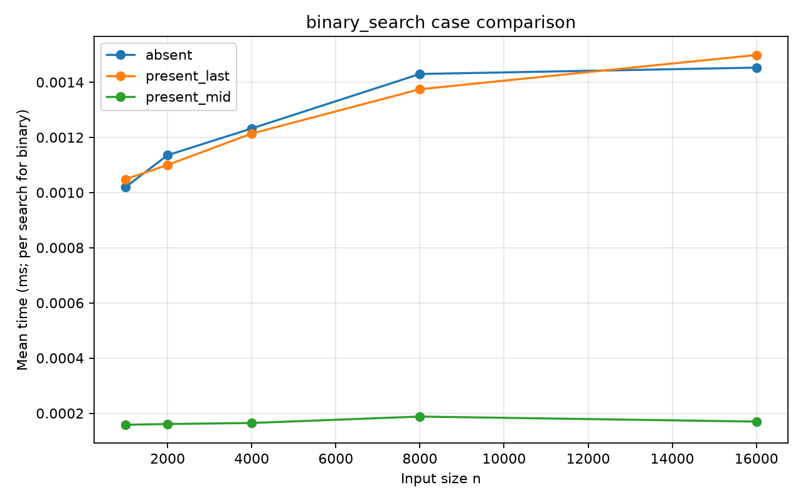
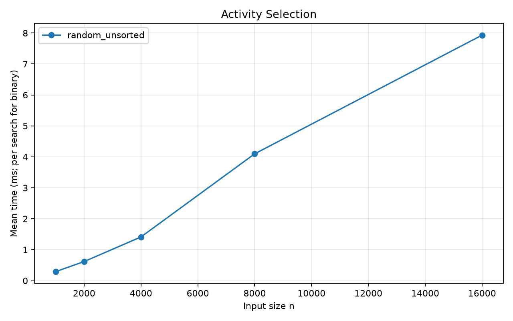
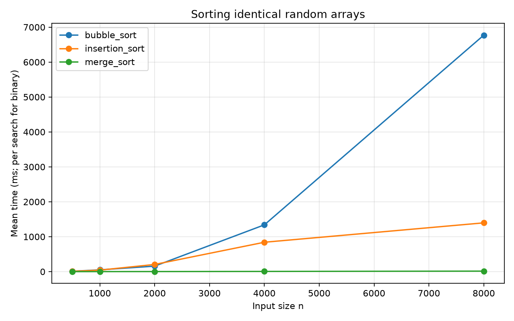

# Implementation and Experimental Analysis of Algorithms Using an Open-Source Tool

Institute: Maharaja Agrasen Institute of Technology, Delhi

Department: Computer Science & Engineering; Faculty: Dr. Jyoti Kaushik; Paper code: CIC-311

STUDENT_NAME: ________ (not supplied)

ENROLLMENT_NUMBER: ________ (not supplied)

SEMESTER_SECTION: ________ (not supplied)

ACTUAL_SUBMISSION_DATE: ________ (not supplied)

PYTHON_VERSION: 3.14.0

EDITOR_AND_VERSION: Not recorded; Python CLI used

MATPLOTLIB_VERSION: 3.11.2

PYTEST_VERSION: 9.2.0

OS_VERSION: Windows-11-10.0.26300-SP0

CPU_INFO: Intel64 Family 6 Model 170 Stepping 4, GenuineIntel

BENCHMARK_DATE: 2026-11-16T22:15:40.410959+00:00

SEED: 20261117

GIT_COMMIT_OR_NOT_AVAILABLE: Not available

## Objective
Implement five algorithms from sorting, divide and conquer, and greedy methods, and compare measured growth with theory.

## Experimental methodology
Three trials per condition; deterministic seed 20261117. Integer sorting inputs are generated uniformly from [-n,10n); identical baseline tuples are copied outside timing for each algorithm. Supplemental cases sort/reverse the same seeded values. All sorting functions mutate their supplied copy. Activities use random starts in [-n,10n) and positive durations 1..100. Sorting activities by finish time is included. Reference validation precedes timing; output checks follow it. Timer: perf_counter_ns; resolution 1e-07 seconds. Binary input is range(n); present_mid matches the initial midpoint, present_last targets n-1 and absent targets n. A common calibrated batch of 524288 calls is used; totals are divided by calls. Every result enters a checksum checked afterward. Loop/checksum overhead is included without subtraction. Calibration is excluded. No explicit warmup beyond prevalidation. Arithmetic means and sample SD are computed from raw records. Ratios compare each row to the preceding half-size row. OS scheduling, background load, caches, Python overhead and uncontrolled power mode can affect results; three trials do not establish statistical significance. The original assignment PDF was unavailable; source alignment follows plan.md. Identity and actual submission date remain deliberately blank. Experiment date is distinct from the source's printed 15 November 2026 deadline.

## Algorithm A1: Bubble Sort
```text
for end from n-1 down to 1: swapped=false; compare adjacent pairs up to end; swap inverted pairs and set swapped; break if no swap; return A
```

Best O(n); average/worst O(n^2); O(1) auxiliary space. Early exit detects sorted input. Strict swaps preserve stability. Each pass fixes the largest remaining item.

Boundary, negative, duplicate, ascending, descending and seeded random arrays match the independent sorted oracle; identity and stability are tested.

| Input size n | Run 1 (ms) | Run 2 (ms) | Run 3 (ms) | Average (ms) | T(2n)/T(n) |
|---:|---:|---:|---:|---:|---:|
| 500 | 10.706400000 | 12.619100000 | 10.706300000 | 11.343933333 | ? |
| 1000 | 48.302100000 | 52.600900000 | 54.156800000 | 51.686600000 | 4.5563 |
| 2000 | 153.290000000 | 154.088400000 | 164.326200000 | 157.234866667 | 3.0421 |
| 4000 | 664.646500000 | 1764.295700000 | 1589.654400000 | 1339.532200000 | 8.5193 |
| 8000 | 6359.730200000 | 7075.436800000 | 6878.412500000 | 6771.193166667 | 5.0549 |




Primary case: random. Mean time rises from 11.343933333 ms to 6771.193166667 ms across the tested endpoints. Adjacent ratios span 3.042?8.519. Quadratic growth suggests ratios near 4; constants differ because bubble swaps adjacent entries while insertion shifts entries.

### Supplemental reverse_sorted
| Input size n | Run 1 (ms) | Run 2 (ms) | Run 3 (ms) | Average (ms) | T(2n)/T(n) |
|---:|---:|---:|---:|---:|---:|
| 250 | 6.451200000 | 5.952800000 | 6.349700000 | 6.251233333 | ? |
| 500 | 28.912000000 | 26.240200000 | 28.014500000 | 27.722233333 | 4.4347 |
| 1000 | 121.794600000 | 127.116300000 | 115.437300000 | 121.449400000 | 4.3809 |
| 2000 | 530.186100000 | 515.563800000 | 534.739100000 | 526.829666667 | 4.3379 |
| 4000 | 2304.760100000 | 2319.895000000 | 2206.948100000 | 2277.201066667 | 4.3225 |

### Supplemental sorted
| Input size n | Run 1 (ms) | Run 2 (ms) | Run 3 (ms) | Average (ms) | T(2n)/T(n) |
|---:|---:|---:|---:|---:|---:|
| 250 | 0.174800000 | 0.029800000 | 0.029700000 | 0.078100000 | ? |
| 500 | 0.060400000 | 0.064100000 | 0.064500000 | 0.063000000 | 0.8067 |
| 1000 | 0.143200000 | 0.135700000 | 0.134200000 | 0.137700000 | 2.1857 |
| 2000 | 0.258500000 | 0.276900000 | 0.277200000 | 0.270866667 | 1.9671 |
| 4000 | 0.526600000 | 0.584500000 | 0.581100000 | 0.564066667 | 2.0825 |


Sorted bubble/insertion have linear fast paths; reverse input has quadratic work. Merge remains linearithmic across these cases.

## Algorithm A2: Insertion Sort
```text
for i from 1 to n-1: save key=A[i]; shift larger prefix entries right; insert key at its position; return A
```

Best O(n); average/worst O(n^2); O(1) auxiliary space. Strict shifts preserve stability. The sorted prefix grows by one each pass.

Boundary, negative, duplicate, ascending, descending and seeded random arrays match the independent sorted oracle; identity and stability are tested.

| Input size n | Run 1 (ms) | Run 2 (ms) | Run 3 (ms) | Average (ms) | T(2n)/T(n) |
|---:|---:|---:|---:|---:|---:|
| 500 | 10.272300000 | 10.536800000 | 9.813000000 | 10.207366667 | ? |
| 1000 | 40.986500000 | 44.124800000 | 44.595000000 | 43.235433333 | 4.2357 |
| 2000 | 210.281100000 | 202.172900000 | 204.116400000 | 205.523466667 | 4.7536 |
| 4000 | 802.836200000 | 835.146200000 | 886.137500000 | 841.373300000 | 4.0938 |
| 8000 | 1968.608400000 | 1111.289800000 | 1110.949000000 | 1396.949066667 | 1.6603 |




Primary case: random. Mean time rises from 10.207366667 ms to 1396.949066667 ms across the tested endpoints. Adjacent ratios span 1.660?4.754. Quadratic growth suggests ratios near 4; constants differ because bubble swaps adjacent entries while insertion shifts entries.

### Supplemental reverse_sorted
| Input size n | Run 1 (ms) | Run 2 (ms) | Run 3 (ms) | Average (ms) | T(2n)/T(n) |
|---:|---:|---:|---:|---:|---:|
| 250 | 2.770400000 | 2.790400000 | 2.218400000 | 2.593066667 | ? |
| 500 | 7.300100000 | 7.301000000 | 10.629200000 | 8.410100000 | 3.2433 |
| 1000 | 31.441000000 | 41.531500000 | 31.186300000 | 34.719600000 | 4.1283 |
| 2000 | 134.894600000 | 135.757100000 | 129.812500000 | 133.488066667 | 3.8447 |
| 4000 | 545.901100000 | 530.657900000 | 537.019200000 | 537.859400000 | 4.0293 |

### Supplemental sorted
| Input size n | Run 1 (ms) | Run 2 (ms) | Run 3 (ms) | Average (ms) | T(2n)/T(n) |
|---:|---:|---:|---:|---:|---:|
| 250 | 0.064300000 | 0.019700000 | 0.018800000 | 0.034266667 | ? |
| 500 | 0.039700000 | 0.039700000 | 0.040400000 | 0.039933333 | 1.1654 |
| 1000 | 0.080200000 | 0.079300000 | 0.080600000 | 0.080033333 | 2.0042 |
| 2000 | 0.178300000 | 0.165100000 | 0.168000000 | 0.170466667 | 2.1299 |
| 4000 | 0.550900000 | 0.546300000 | 0.595400000 | 0.564200000 | 3.3097 |


Sorted bubble/insertion have linear fast paths; reverse input has quadratic work. Merge remains linearithmic across these cases.

## Algorithm A3: Merge Sort
```text
if n<=1 return A; recursively sort both halves; merge by taking smaller head (left on ties); copy merged sequence into A; return A
```

Best/average/worst O(n log n); O(n) auxiliary space plus O(log n) recursion depth. Balanced splitting and linear stable merging preserve order.

Boundary, negative, duplicate, ascending, descending and seeded random arrays match the independent sorted oracle; identity and stability are tested.

| Input size n | Run 1 (ms) | Run 2 (ms) | Run 3 (ms) | Average (ms) | T(2n)/T(n) |
|---:|---:|---:|---:|---:|---:|
| 500 | 0.594400000 | 0.565200000 | 0.573100000 | 0.577566667 | ? |
| 1000 | 1.265900000 | 1.986800000 | 1.238400000 | 1.497033333 | 2.5920 |
| 2000 | 2.741900000 | 2.726000000 | 2.773900000 | 2.747266667 | 1.8351 |
| 4000 | 5.905800000 | 6.091200000 | 5.902200000 | 5.966400000 | 2.1718 |
| 8000 | 13.563100000 | 16.450800000 | 13.656300000 | 14.556733333 | 2.4398 |




Primary case: random. Mean time rises from 0.577566667 ms to 14.556733333 ms across the tested endpoints. Adjacent ratios span 1.835?2.592. Linearithmic growth suggests ratios slightly above 2; allocation, adaptive sorting and interpreter costs can shift these.

### Supplemental reverse_sorted
| Input size n | Run 1 (ms) | Run 2 (ms) | Run 3 (ms) | Average (ms) | T(2n)/T(n) |
|---:|---:|---:|---:|---:|---:|
| 250 | 0.254400000 | 0.380800000 | 0.360100000 | 0.331766667 | ? |
| 500 | 0.509300000 | 0.494500000 | 0.486000000 | 0.496600000 | 1.4968 |
| 1000 | 1.077200000 | 2.213600000 | 1.064100000 | 1.451633333 | 2.9231 |
| 2000 | 2.328100000 | 2.447300000 | 2.338800000 | 2.371400000 | 1.6336 |
| 4000 | 7.416900000 | 4.914200000 | 6.675200000 | 6.335433333 | 2.6716 |

### Supplemental sorted
| Input size n | Run 1 (ms) | Run 2 (ms) | Run 3 (ms) | Average (ms) | T(2n)/T(n) |
|---:|---:|---:|---:|---:|---:|
| 250 | 0.274000000 | 0.222300000 | 0.221300000 | 0.239200000 | ? |
| 500 | 0.499500000 | 0.481100000 | 0.772900000 | 0.584500000 | 2.4436 |
| 1000 | 1.058500000 | 1.074300000 | 1.047900000 | 1.060233333 | 1.8139 |
| 2000 | 2.330300000 | 2.262100000 | 2.262500000 | 2.284966667 | 2.1552 |
| 4000 | 5.097000000 | 6.165200000 | 5.541900000 | 5.601366667 | 2.4514 |


Sorted bubble/insertion have linear fast paths; reverse input has quadratic work. Merge remains linearithmic across these cases.

## Algorithm A4: Binary Search
```text
low=0; high=n-1; while low<=high: mid=low+(high-low)//2; return mid on equality; otherwise discard half by updating low or high; return -1
```

Sorted input is required. Best O(1), average/worst O(log n); O(1) space. Each unsuccessful iteration discards half the candidate interval without discarding a possible match.

All targets across seeded sorted arrays, duplicates, empty inputs and out-of-range misses are checked; input preservation is tested.

| Input size n | Run 1 (ms) | Run 2 (ms) | Run 3 (ms) | Average (ms) | T(2n)/T(n) |
|---:|---:|---:|---:|---:|---:|
| 1000 | 0.001023350 | 0.001022857 | 0.001012701 | 0.001019636 | ? |
| 2000 | 0.001167026 | 0.001121878 | 0.001117326 | 0.001135410 | 1.1135 |
| 4000 | 0.001225711 | 0.001214819 | 0.001256277 | 0.001232269 | 1.0853 |
| 8000 | 0.001398416 | 0.001527940 | 0.001362810 | 0.001429722 | 1.1602 |
| 16000 | 0.001460193 | 0.001443563 | 0.001454638 | 0.001452798 | 1.0161 |




Primary case: absent. Mean time rises from 0.001019636 ms to 0.001452798 ms across the tested endpoints. Adjacent ratios span 1.016?1.160. These are amortized per-search times. Logarithmic growth predicts ratios close to 1, not 2; fixed batch-loop overhead can flatten the trend.

### Supplemental present_last
| Input size n | Run 1 (ms) | Run 2 (ms) | Run 3 (ms) | Average (ms) | T(2n)/T(n) |
|---:|---:|---:|---:|---:|---:|
| 1000 | 0.001059001 | 0.001024579 | 0.001060464 | 0.001048015 | ? |
| 2000 | 0.001086694 | 0.001127529 | 0.001085651 | 0.001099958 | 1.0496 |
| 4000 | 0.001212973 | 0.001209214 | 0.001219091 | 0.001213759 | 1.1035 |
| 8000 | 0.001400803 | 0.001368594 | 0.001354012 | 0.001374470 | 1.1324 |
| 16000 | 0.001516702 | 0.001455936 | 0.001523317 | 0.001498652 | 1.0903 |

### Supplemental present_mid
| Input size n | Run 1 (ms) | Run 2 (ms) | Run 3 (ms) | Average (ms) | T(2n)/T(n) |
|---:|---:|---:|---:|---:|---:|
| 1000 | 0.000169029 | 0.000154923 | 0.000150429 | 0.000158127 | ? |
| 2000 | 0.000162028 | 0.000156454 | 0.000164121 | 0.000160868 | 1.0173 |
| 4000 | 0.000165065 | 0.000168427 | 0.000160378 | 0.000164624 | 1.0233 |
| 8000 | 0.000208001 | 0.000184182 | 0.000171633 | 0.000187938 | 1.1416 |
| 16000 | 0.000166874 | 0.000179998 | 0.000162125 | 0.000169666 | 0.9028 |


The midpoint case has constant search work; endpoint and absent cases take logarithmically many iterations.

## Algorithm A5: Activity Selection
```text
sort by (finish,start,id); last=-infinity; for each activity: if start>=last, select it and set last=finish; return selected
```

Unsorted input has O(n log n) worst-case total time, including sorting, then O(n) scan; O(n) space. Python's adaptive sort can be linear on ordered input; random unsorted inputs have expected O(n log n) sorting work. Replacing the first activity of an optimum with an earliest-finishing activity leaves at least as much room for the rest, proving the greedy choice by induction.

Empty/singleton, ties, touching boundaries, overlapping and disjoint sets pass. Exhaustive subset enumeration independently checks optimal counts for small seeded cases; membership, non-overlap, unique IDs and input preservation are checked.

| Input size n | Run 1 (ms) | Run 2 (ms) | Run 3 (ms) | Average (ms) | T(2n)/T(n) |
|---:|---:|---:|---:|---:|---:|
| 1000 | 0.283300000 | 0.305100000 | 0.289900000 | 0.292766667 | ? |
| 2000 | 0.603800000 | 0.633600000 | 0.615600000 | 0.617666667 | 2.1098 |
| 4000 | 1.356100000 | 1.424200000 | 1.457800000 | 1.412700000 | 2.2872 |
| 8000 | 4.336000000 | 3.266000000 | 4.691100000 | 4.097700000 | 2.9006 |
| 16000 | 7.245000000 | 7.527300000 | 9.021100000 | 7.931133333 | 1.9355 |




Primary case: random_unsorted. Mean time rises from 0.292766667 ms to 7.931133333 ms across the tested endpoints. Adjacent ratios span 1.936?2.901. Linearithmic growth suggests ratios slightly above 2; allocation, adaptive sorting and interpreter costs can shift these.

Full greedy sorting cost is included; no scan-only experiment was used.

## Combined sorting comparison


## Ranking and speedups
| n | Fastest | Ranking (fast to slow) | Bubble / Merge | Insertion / Merge |
|---:|---|---|---:|---:|
| 500 | merge_sort | merge_sort < insertion_sort < bubble_sort | 19.641 | 17.673 |
| 1000 | merge_sort | merge_sort < insertion_sort < bubble_sort | 34.526 | 28.881 |
| 2000 | merge_sort | merge_sort < bubble_sort < insertion_sort | 57.233 | 74.810 |
| 4000 | merge_sort | merge_sort < insertion_sort < bubble_sort | 224.513 | 141.019 |
| 8000 | merge_sort | merge_sort < insertion_sort < bubble_sort | 465.159 | 95.966 |

Ratios divide the named numerator runtime by Merge Sort runtime; values above 1 mean Merge is faster.

## Crossovers
No observed crossover in tested range.

## Theoretical vs practical complexity
| Algorithm | Primary expected time | Mean adjacent ratio |
|---|---|---:|
| bubble_sort | O(n^2) | 5.2932 |
| insertion_sort | O(n^2) | 3.6859 |
| merge_sort | O(n log n) | 2.2597 |
| binary_search | O(log n) | 1.0938 |
| activity_selection | O(n log n) | 2.3083 |
Guides: linear ~2, quadratic ~4, linearithmic slightly above 2, logarithmic and constant near 1. Finite measurements are consistent with or deviate from these guides; they do not prove asymptotic bounds.

## Conclusion
1. At the largest tested sorting input, merge_sort was fastest.
2. No observed crossover in tested range.
3. Bubble and insertion perform the same task but incur different operation costs.
4. The supplemental sorted inputs exercise the early-exit and no-shift paths.
5. Merge uses additional memory to avoid quadratic merging work.
6. Binary search timings are per call, normalized from checksum-consuming batches.
7. Activity selection measurements include the prerequisite ordering step.
8. Measured doubling ratios reflect finite sizes and platform noise as well as growth.
9. The raw records, deterministic inputs and regeneration commands support independent reproduction.

## Reproducibility and references
See [README](../README.md) for complete commands and [raw measurements](../data/raw/measurements.csv). Source: supplied plan.md, transcribing DAA_Assignment_Dr_Jyoti_Kaushik.pdf (PDF not available for independent review). No repository has been published.

## Validation
See [checks](checks.md) and [test output](../logs/validation.txt). Student identity and submission date must be completed before submission.
